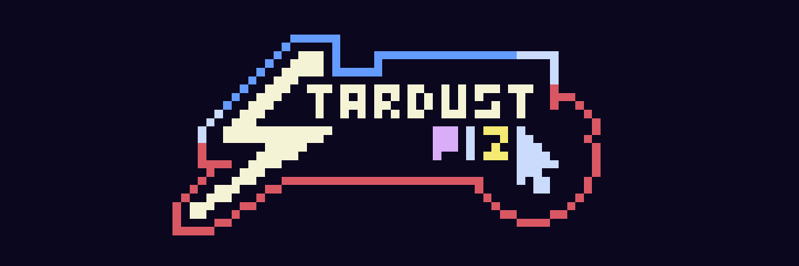
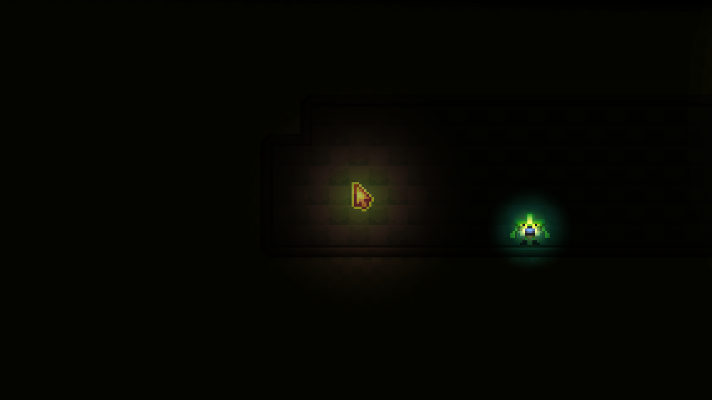
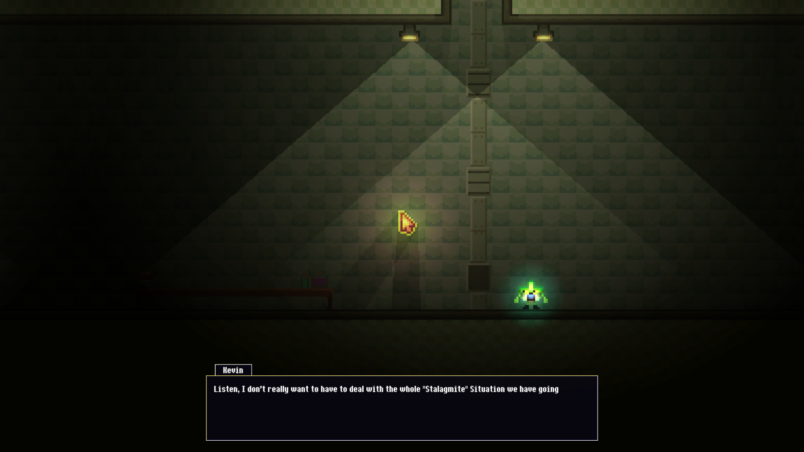
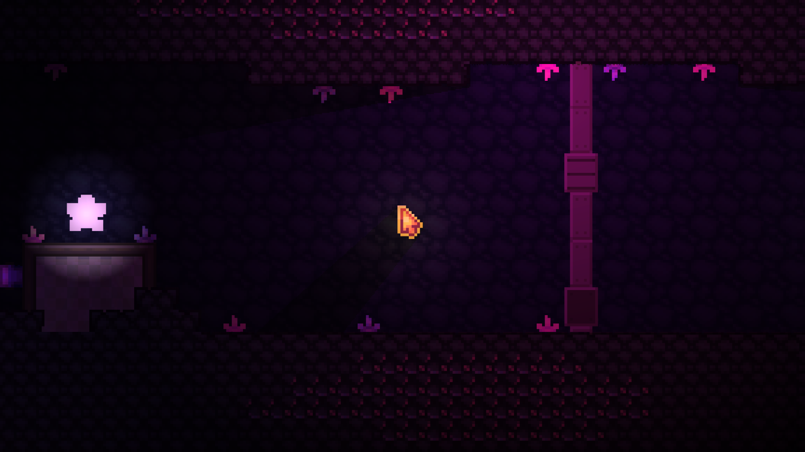
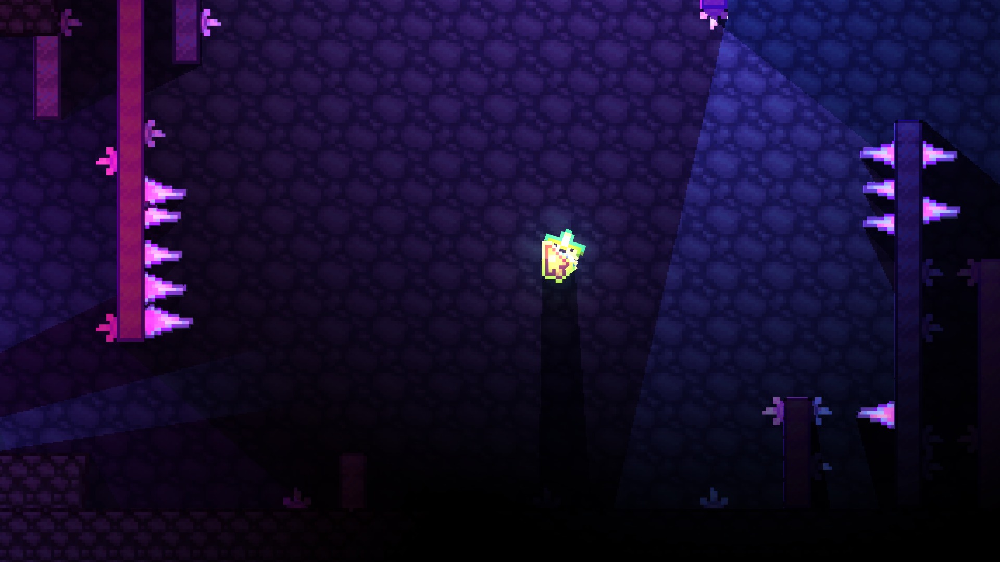

<p align="center">
    
  
Stardust Plz, or as I will call it "SDP," is a simple single-player RPG-like game about an adventure with your friend. The game was originally much larger in scale, but it had to be cut down for time reasons. This is actually my first-ever game, so please don't be too hard on it!

> [!NOTE]
> This is my first-ever game! So expect bugs...

> [!IMPORTANT]
> This game has A LOT of unused assets. The spritesheet I used is in the Repository so you can see everything I drew; there's also a lot of hidden surprises inside the files anyway, so I encourage you to go digging around that assets folder!

## Install

https://github.com/Inooty/stardust-plz/releases/tag/1.0

### Linux (Flatpak)
```bash
curl -L -O https://github.com/Inooty/stardust-plz/releases/download/1.0/sdp.flatpak
flatpak install --user sdp.flatpak
flatpak run io.github.inooty.StardustPlz
```
### Windows
```bash
curl.exe -L -O https://github.com/Inooty/stardust-plz/releases/download/1.0/sdp-windows.exe
curl.exe -L -O https://github.com/Inooty/stardust-plz/releases/download/1.0/sdp-windows.pck
.\sdp-windows.exe
```

## Full Walkthrough
<p align="center">
  <a href="https://youtu.be/OaHIz6fC9JU">
    
  </a>
</p>

## Why is it based on the Stardance Characters?
I wanted to make a game that could only really be made as a result of this competition, so whenever the extension of the competition was announced, and the Beans & Bukus were introduced to the Stardance "Lore," if you will, I saw the perfect opportunity to make a game about it! But... I made one fatal mistake

I forgot the Cyan 6-Pointed Star and the Galaxy Character; sorry, I don't know their names, couldn't find them anywhere. As I was saying, I completely forgot to add them, so I pulled some strings and changed the lore around a bit, turning them into Gods the Starlings Worship, simplifying things for me a lot, since if they were factions like the Beans & Bukus, it would double my workload and honestly, not be worth it.

## Why The Name?
The game's original ending was gonna be all the Starlings "Fusing" together to prevent you from stealing all their Stardust, no matter which faction you chose, so basically the Starlings were asking you for their Stardust back, hence the name "Stardust Plz." Other than that, it was just a joke about how some people just beg for Stardust, and I wanted to allude to that in a sort of playful way. And it's also just really funny seeing people ask "Why is it called Stardust Plz?"

## Why was the Decision to turn them into Factions made?
Well, the Starling mascots for the competition are intentionally just meant to be cute little guys, you know, just mascots. But you can't really make a game about that (don't quote me on that). So since they are doing the whole Bean VS Buku thing, I thought it would be neat to turn it into a sort of "Autobot VS Decepticon" sort of relationship. This also inspired the idea for multiple campaigns. Which I think makes the game stand out a lot more compared to other Godot games in the competition. Unfortunately, this idea was ultimately scrapped due to time. However, the Buku Campaign will be added if the game ever gets a Full Release (Most of the stuff is in the files already)

## What's Next?
This game probably won't get any updates after the Stardance Competition is complete (Unless they make Stardance 2, as promised in the credits), because I want to move on to other things, and this was just a fun idea I came up with when thinking of a secondary project. (Yes, this was meant to be a short and quick project I was gonna do before I moved on to working on Riftbook again) But as you can tell, it spiraled out of control, and now we're here.

## Credits
These are also viewable in-game.

### General:
Assets: Inoty
Dialogue: Inoty
Dialogue System: Claude
Save System: Claude
Game Engine: Godot
Playtesters: My Friends & Classmates
Technical Help: Claude (Thank you, Claude)
Writing: Inoty

### Music:
Cave Ambience: Dark CAVE / Ambience SOUND Effect (NO Copyright) by The Audio Horizon SFX
Gelatin Caves Music: Crystal Cave • Royalty Free Game Music by Zef Parisoto
Sunset | Melody Free Background Music | NO COPYRIGHT 2020 | DOWNLOADABLE MUSIC by No Copyright Music and Video Themes
Melancholic Cinematic (Free Music) - "A KIND OF HOPE" by Scott Buckley
Casual Game Music 09 By Ivan Formin
All These can be found on Youtube

### Sound Effects:
BUBBLE POP SOUND EFFECT - FREE by Sound FX
Broken light bulb sound effect by pbelz4759
WALKING ON METAL SURFACE SOUND EFFECT - FREE
 by Sound FX
Crumbling sound effect by 1000s sound effects
Undertale Death Sound Effect
 by Canned Sound Collection
The Starling SFX are just some Meowing SFX really speed up (I forgot the origianal source)
All these can be found on Youtube

Special Thanks: To everyone who commented on the devlogs, or said nice things about the game. It really boosted my motivation to keep working on it.

## Game Screenshots
<p align="center">
    
    <p align="center">
    
    <p align="center">
    
    <p align="center">
    
